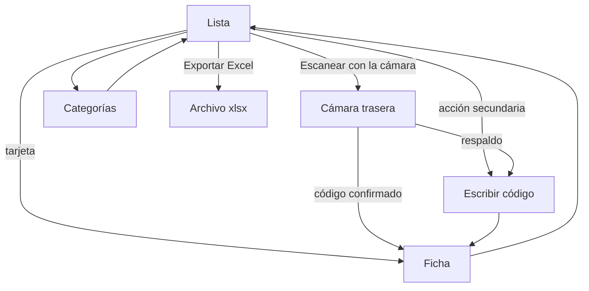

# Mapa de navegación

No hay rutas de URL. Es una sola página. Volver siempre regresa a la lista y apaga la cámara.

Con la lista vacía, **Escanear con la cámara** está en la cabecera papaya. Cuando ya hay productos, el mismo botón queda fijo en el pie. **Escribir código** no pasa a ser la acción principal.

En el visor, la barra tiene **Cerrar**, el título y **Escribir código**. **Flash** se agrega a la derecha de esa barra, debajo de escribir el código, solo cuando la cámara informa que puede encender la luz. No tapa el recuadro. Cerrar el visor o salir de la página apaga la luz y la cámara.
